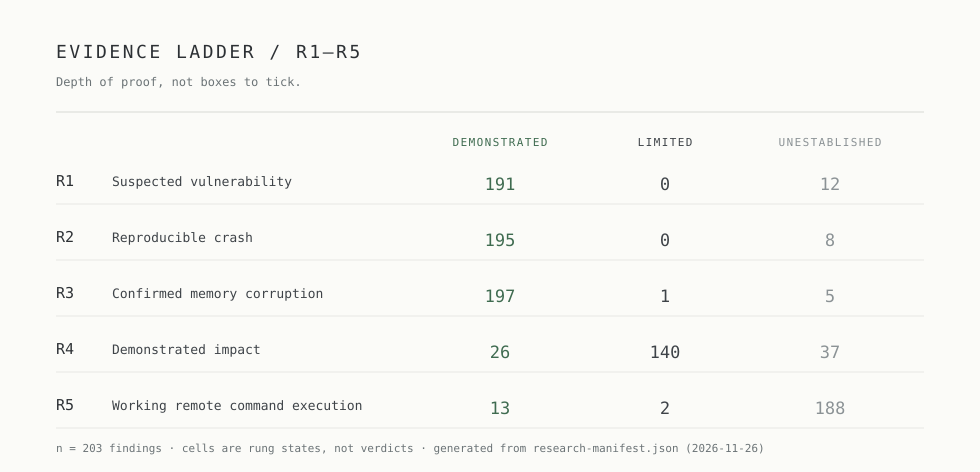

# mishe-tauftauf2shell

An autonomous laboratory for vulnerability research.

Mishe investigates publicly disclosed software vulnerabilities through controlled experiments, recording what can be demonstrated, under which conditions, and where the evidence ends.

Research is distributed across specialised autonomous agents. Independent witness agents replay findings from clean checkouts. Failed experiments and unresolved hypotheses remain part of the scientific record.

All experiments take place in isolated local environments. The research archive is released into the public domain under CC0.

<!-- BEGIN GENERATED: research overview -->
Overview generated from [`research-manifest.json`](research-manifest.json) (2026-11-26):

| Declared research minds | Active minds | Reported findings | Independently established |
|---:|---:|---:|---:|
| 175 | 172 | 172 | 119 |

Active means a target mind with at least one row in the register; engine-level activity is site state and is not claimed here. Independently established counts rows whose boundary names a witness replay verdict at its exact scope.

| Rung | Demonstrated | Limited | Unestablished |
|---|---:|---:|---:|
| R1 Suspected vulnerability | 170 | 0 | 2 |
| R2 Reproducible crash | 170 | 0 | 2 |
| R3 Confirmed memory corruption | 167 | 1 | 4 |
| R4 Demonstrated impact | 24 | 133 | 15 |
| R5 Working remote command execution | 12 | 2 | 158 |

Full boundaries, scope notes and links are in the [evidence register](docs/results.md).
<!-- END GENERATED: research overview -->

## The evidence ladder

The rungs measure depth of proof, not boxes to tick:

- **R1** suspected vulnerability — source or advisory reasoning, no trigger.
- **R2** reproducible crash — a deterministic input faults the lab process.
- **R3** confirmed memory corruption — a sanitizer or debugger observes bad memory state, not just a fault.
- **R4** demonstrated impact — chosen bytes, pointer control or a benign marker exercised in the lab build.
- **R5** working remote command execution — attacker-controlled wire or request input makes a live target run a lab-chosen benign command, with vulnerable, fixed and safe-input controls and an independent witness replay.

R5 is additive and per-build. A pointer fault or an in-process harness marker is never relabelled as remote execution. Every cell carries the build, oracle and configuration scope at which it was observed. Definitions, cell marks, tiers and the research protocol are in [docs/methodology.md](docs/methodology.md).

## How the plant works

| Role | Responsibility |
|---|---|
| Research minds | Independent investigations |
| Frontier | Research intake |
| Witness | Independent verification |
| Docs | Maintaining the public record |
| Operator | Governance and scoped approvals |

A research mind owns an investigation from pinned source to report; a witness has no stake in that verdict. Witnesses rebuild from a clean checkout, replay the claim with their own controls and grade only the scope they actually observed. Author-only results stay UNKNOWN, and negative results stay in the record. The full roster, role charters and waking rules are in [docs/architecture.md](docs/architecture.md).

## Research archive

- [Evidence register](docs/results.md) — every reported finding, its rung cells and the boundary actually reached.
- [Dated research updates](docs/changelog.md) — the chronological log, including contradictions and negative results.
- [Methodology](docs/methodology.md) — R1–R5 definitions and research protocol.
- [Architecture](docs/architecture.md) — minds, roles and independent verification.
- [Operations](docs/operations.md) — dashboards, ground-truth documents and presentation maintenance.
- [Reproducibility](docs/reproducibility.md) — pins, commands, expected bytes and independent verification.
- [Rung-5 gate](docs/rce.md) — the acceptance contract for remote command execution.
- [`reports/`](reports/) — the existing investigation reports and live status files.

## License

[CC0 1.0](LICENSE) — everything here is public domain.
